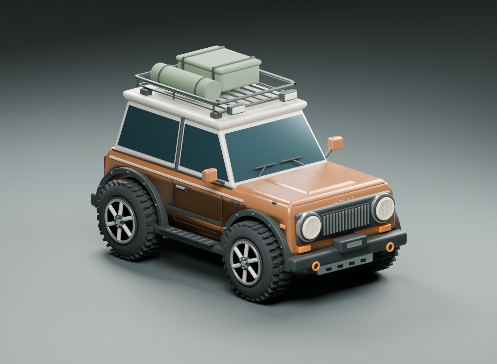
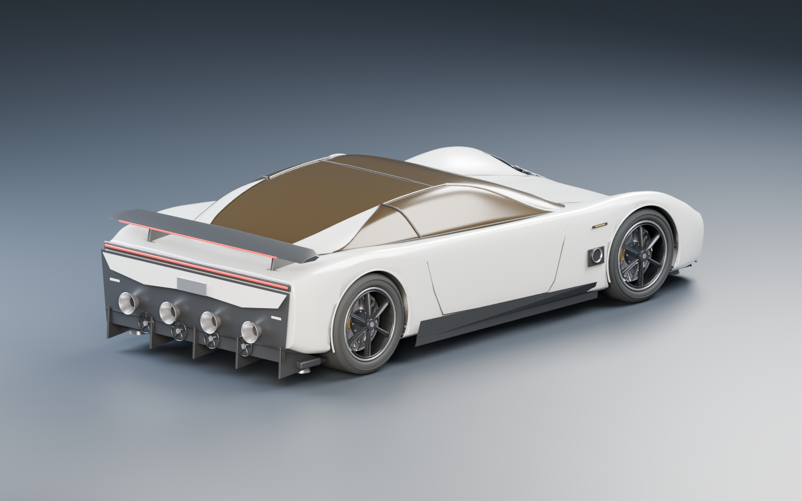
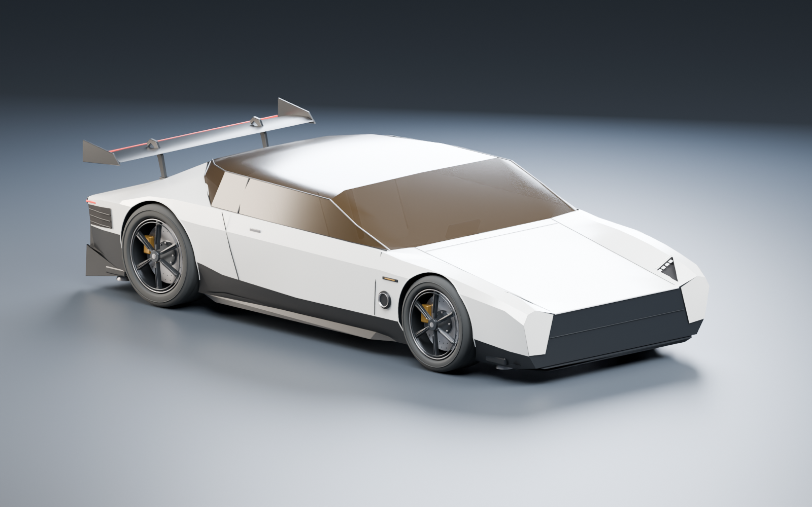

# Endless Drive

**Play it: [project-magellan.pages.dev](https://project-magellan.pages.dev/)**

An endless, procedurally generated world to drive, sail and fly through: meadows, pine country, deserts, snowy ridges, lakes, rivers and inland seas, with jump ramps, barrel-roll ramps, camps and lookout towers along the way. Your vehicle, the ATLAS, is an off-road 4×4 that turns into a boat in deep water and unfolds into a plane on demand. Or take the Roadster, a low supercar with cold-gas thrusters that boosts, hovers and skims across lakes.

Every visit generates a new world. Add `?seed=123456` to a link to share or revisit the same one.


<table>
  <tr>
    <td width="50%"><br><sub><b>Boat mode.</b> Drive into deep water and the car becomes a boat.</sub></td>
    <td width="50%"><br><sub><b>Flying.</b> Unfold the wings anywhere and take off.</sub></td>
  </tr>
  <tr>
    <td><br><sub><b>The Roadster.</b> A second car: its rear thrusters boost it to 97 km/h in 0.6 s.</sub></td>
    <td><br><sub><b>Hovering.</b> Hold F to hover; over water it skims on its jets.</sub></td>
  </tr>
  <tr>
    <td colspan="2"><br><sub><b>Roadster HUD.</b> Red telemetry on black glass: pedals, a g-meter, the wing, fans and thrusters, and thruster pressure. Press V to swap cars mid-drive.</sub></td>
  </tr>
  <tr>
    <td><br><sub><b>Inland seas.</b> Lakes and seas stretch to the horizon from the air.</sub></td>
    <td><br><sub><b>Rivers and bridges.</b> Rivers wind down to the seas, and roads bridge them.</sub></td>
  </tr>
  <tr>
    <td><br><sub><b>Road network.</b> Highways, country roads, junctions and roundabouts.</sub></td>
    <td><br><sub><b>Dirt tracks.</b> Roads through forests and mountains turn to dirt.</sub></td>
  </tr>
  <tr>
    <td><br><sub><b>Jump ramps.</b> Orange ramps launch you automatically.</sub></td>
    <td><br><sub><b>Barrel rolls.</b> Purple ramps twist you into a roll.</sub></td>
  </tr>
  <tr>
    <td><br><sub><b>The Sandlands.</b> Deserts, pine woods, meadows and mountains.</sub></td>
    <td><br><sub><b>The Peaks.</b> Snow falls on the high ground and settles on the tracks.</sub></td>
  </tr>
  <tr>
    <td><br><sub><b>Day and night.</b> The sun rises and sets, and dusk glows pink.</sub></td>
    <td><br><sub><b>Night.</b> Drive by moonlight and headlights.</sub></td>
  </tr>
  <tr>
    <td colspan="2"><br><sub><b>Weather.</b> Each region has its own climate: rain in the pines, snow on the peaks, sun in the desert. Rain leaves the roads wet and shiny.</sub></td>
  </tr>
</table>

- [Running it locally](#running-it-locally)
- [Controls](#controls)
- [What's in the world](#whats-in-the-world)
- [Settings](#settings)
- [Development](#development)
- [How it works](#how-it-works)

## Running it locally

There's no build step. Serve the folder over HTTP (opening `index.html` as a file won't work):

```sh
python3 -m http.server 8000 --bind 127.0.0.1
```

Then open [localhost:8000](http://localhost:8000). For development, `npm run dev` serves on port 8002 with caching disabled.

You need a browser with WebGL and module workers. Everything else is bundled: Three.js 0.160.0 lives in `vendor/` with its license, and the game runs without any external connection (Google Fonts are optional, with system font fallbacks).

## Controls

### Driving

| Key | Action |
| --- | --- |
| W / ↑ | Accelerate |
| S / ↓ | Brake, then reverse |
| A D / ← → | Steer |
| Space | Jump (stopped or moving) |
| Shift | Handbrake / drift |
| F | Unfold the wings to fly; press again to fold them and land. Roadster: hold to hover on the thrusters |
| E | Roadster: boost on the rear thrusters (hold) |
| G | Roadster: suction fans on / off |
| R | Recover onto nearby clear ground |
| C | Camera: chase, wide or bonnet |
| V | Switch between the ATLAS and the Roadster where you are (also the ⇄ button at the top right) |
| L | Headlights |
| M | Mute / unmute |
| Esc / P | Pause / resume |
| N | New world |
| 1 / 2 / 3 / 4 | Jump to sunrise, noon, sunset or night (also **Time** in the menu) |

In the water the same keys drive the boat: W/S thrust, A/D steer, Shift slows down. You can't jump while floating. The Roadster never floats: over water it skims on its thrusters and drives as it does on land.

### Flying

Flight has two control schemes. Every visit starts on **full controls**; press **T** (or **SIMPLE** on touch) to switch for that visit.

| Key | Full controls | Simple controls |
| --- | --- | --- |
| W / S | Throttle / air brake | Throttle / air brake |
| ↑ / ↓ | Pitch, flight-stick style (↓ pulls the nose up) | Throttle |
| Space / Shift | Climb / dive (pitch) | Climb / dive, holding level when released |
| A / D, ← / → | Roll | Bank and turn; the wings level when released |
| Q / E | Yaw (rudder) | — |
| F | Fold the wings and glide in to land | Same |

### Touch

On phones and compact windows:

- **Steering slider** (lower left): slide to steer. The track stays put, and the knob stops at either end however far your finger travels.
- **↑ / ↓**: accelerate, and brake then reverse.
- **Jump** and **Drift** sit side by side just above the slider. **FLY** is just left of the brake; in the air it becomes **LAND**, with **SIMPLE** above it. In the Roadster it's **HOVER** (hold it), with **BOOST** and **FANS** (suction on / off) beside it.
- **Flight ring:** in the air the steering slider becomes a ring in the same spot. Drag the knob up to climb, down to dive, and sideways to roll (or turn, on simple controls). The ring stays put, the knob stops at its edge and re-centres when you let go, and ↑ / ↓ are the throttle.
- **Tilt steering** (menu → **Settings** → **Tilt steering**, off by default): turn the phone like a steering wheel to steer; full lock is about 35° of turn. The slider steps aside, and Jump and Drift stay put. In the air, turning rolls (or turns, on simple controls), and tilting the top toward you climbs and away dives, measured from how you held the phone when the wings came out. The ring still works and takes over while you touch it. iPhones ask once for motion access when you turn it on.
- **No minimap** on phones, so the controls have room (the HUD still points to the nearest ramp and lake).
- **Fullscreen:** in landscape the game goes fullscreen on your next tap, and leaves it when you turn back to portrait. Safari on iPhone doesn't allow fullscreen for web pages, so on iPhone use Share → **Add to Home Screen**: the game then opens fullscreen like an app.
- **Sensitivity** (50–150%) is in the menu's Settings. It changes how quickly small slider, ring or tilt movements turn; full deflection is always full lock.

The game pauses when the window loses focus. If the browser drops the graphics (phones do when you switch apps), the drive pauses there and carries on from the pause menu once they're restored, with no reload. Sound is on from the start (it begins with your first click or tap, as browsers require); press M to mute, or the speaker button for music and effects volumes, and the game remembers. Trip records and settings are saved in your browser.

## What's in the world

**Terrain.** Open plains around the start give way to hill country and long mountain ranges: sharp, rugged ridgelines with peaks around 350–400 m, crags on the upper slopes, and snow on the tops (THE PEAKS). Rock shows through on steep faces (banded granite in the ranges, layered red sandstone in the desert), loose scree lies on the high slopes, and grass turns to alpine meadow above the treeline. Snow lies lower on shady slopes and slides off the steepest faces. Deserts (the Sandlands) are broad, winding regions with wind-shaped dunes on the flats and flat-topped mesas with cliff walls in the desert hills; try `?seed=100003` to start in one.

**Roads.** Highways (two lanes each way, gentle, in long sweeping curves) link every third waypoint in a grid about 4 km across; country roads join the rest, and those running mostly through forest or mountains are dirt tracks: narrower, unmarked, rutted and bumpy, slower than tarmac and looser than grass, and dusty. Dirt tracks also climb the mountains in hairpins to the high tops, some above the snow line. The network links waypoints about 1.4 km apart, each on the flattest open ground in its cell, and is routed over the land rather than straight across it: roads wind along valleys and around hills, keep clear of water, and never climb more than 11%; where they cross the mountains they climb in hairpin bends. The land is cut and filled to each road's smooth profile, so it runs through cuttings over rises and on embankments across dips; where there would be no way through without a long detour or a deep cutting, there is no road. Where a road crosses a river it does so on a bridge (a concrete deck with railings and piers, about 3 m above the water), reached by long rounded approaches you can take at full speed, and boats pass underneath. The first road runs north from the start.

**On the road.** Where roads meet, the straightest pair through the junction is the main road; side roads end in a stop line across their incoming lane, with a stop sign, and a fingerpost stands on one corner. Now and then a busy junction is a roundabout instead: a ring round a grass island (the fingerpost in the middle), with give-way lines and signs where each road joins it. Lanes lead off the roads at T junctions to the camps and lookouts, and in places a slipway runs down into a lake, so you can drive straight in and sail off. Corners are rounded, and the centre line ends before each junction. It is dashed, but a solid double line on tight bends and blind crests. The asphalt is darker where it's new and paler with age, with repair patches, worn paint, darker wheel tracks and gravel shoulders that fray into the grass; desert roads are sun-bleached with sand drifting over the edges, and in snow the verges turn white and slush gathers at the edges. Rain makes the roads dark and glossy, mirroring the sky and your headlights, with puddles in the dips; at night the lines and roadside reflectors shine back in the headlights. Guardrails line tight bends and high embankments, chevron boards mark the sharpest bends, and white marker posts line the verges. Guardrails are solid: they stop the car. Signs aren't: hit one and it folds over the way you were going, with a clang, and stays down.

**Ramps.** Orange ramps launch you automatically; Space is optional. The first is about 70 m ahead, just right of the starting road. Purple ramps twist and throw you into a left- or right-handed barrel roll; the first is about 225 m ahead on the other side of the road. The minimap shows orange and purple triangles for ramps and pale squares for camps and lookouts, and the HUD points to the nearest ramp and tracks your airtime and best jump.

**Water and the boat.** Small ponds sit on an 840 m grid, and inland seas 1–1.6 km across sit on a sparse 4 km grid (the first is about 1 km from spawn). Each sea is fed by one to three rivers, 2.5–6 km long, that wind up from its shore into the hills, widening from 5 m at the source to 26 m at the mouth; their ripples drift downstream, and most are deep enough to sail. Drive into water deeper than 0.9 m and the ATLAS becomes a boat over 2.4 seconds: the body splits onto planing hulls, the wheels fold away and water jets deploy. Drive back into water shallower than 0.4 m to return to wheels. The water has clear turquoise shallows, reflections of the real sky, sun glitter, shoreline foam, caustics on the lake bed, and boat wakes.

**Flying.** Press F from the car, the boat, or mid-jump. Over 1.6 seconds the tapered wings telescope out of the doors (7.5 m span) and fold their winglets up, twin tail booms slide out of the rear corners and raise an H tail, and a propeller pushes out through the grille and unfolds its blades. On the ground or water the plane taxis and lifts off at about 115 km/h. A jump with the wings half out turns into a glide. It's a real physics model: lift, drag, stalls, a ceiling near 650 m, and a top speed of about 340 km/h. Touch down below flying speed and you land as the car (or as the boat on deep water). Wingtips that touch the ground end the flight, and the wings smash trees and rocks they hit. See [Flight model](#flight-model) for the details.

**The Roadster.** Settings → **Vehicle** swaps the ATLAS for a second car where you are. It's an original low-poly study of the Rocket trim of Tesla's 2026 Roadster, with no badges, built to its published size: a 2.825 m wheelbase, 2 m wide and 1.1 m tall. Its handling comes from the published figures:

| | Claimed | In the game |
| --- | --- | --- |
| 0–60 mph on the tyres | under 1.6 s (Performance trim) | 1.59 s, then power-limited above about 125 km/h (1 MW, 1,700 kg) |
| 0–60 mph with the thrusters | under 0.59 s (Rocket trim) | 0.59 s, holding **E** |
| Top speed | over 230 mph (370 km/h) | 370 km/h on tarmac, about 250 on dirt and 160 on grass; boosting, up to 400 km/h (the 2017 claim of 250 mph) |
| Thrusters | 10 cold-gas nozzles: 4 at the rear, 4 at the corners, 2 on the flanks | The same layout: rear nozzles boost, corner nozzles lift, flank nozzles turn it in the air |
| Gas | 600 L at about 690 bar, 5–6 s of thrust | 5.5 s per group of nozzles; refills in 25 s of driving (a real fill takes hours) |

Its suction fans pull air from under the car on land: it climbs faces up to about 65° (the ATLAS slides back from 48°; past about 72° is a wall), corners about 70% harder, and keeps its wheels down over crests that throw the ATLAS into the air (ramps still launch it). Press **G** to switch the fans off (they start on): it then grips like any car, can't climb past about 45°, and flies off crests in big jumps. Brake or drift at speed and the rear wing swings up about 55° into an air brake, tripling its drag. Hold **F** to lift off: the corner jets climb to a 5 m hover and hold it, slow a fall from a big jump, and the flank jets turn the car on the spot. Deep water doesn't turn it into a boat: the jets hold it 0.4 m above the surface at no cost in gas, and it skims across like a hovercraft at up to about 160 km/h, leaving a wake. Each firing nozzle shows a plume of cold gas, raising vapour from the ground or water beneath. Its HUD turns red on black, with a thruster pressure gauge (10,000 psi full) under the speed and a telemetry panel above it: brake and accelerator, a g-meter, and what the wing, fans and thrusters are doing. The chase camera sits closer and lower than the ATLAS's, stays close at speed, and follows its turns more tightly. Its steer-by-wire answers quicker too: steering reaches 90% of a new input in 0.13 s, against the ATLAS's 0.23 s. `?vehicle=roadster` opens a link in it.

**Day and night.** The sun rises, crosses the sky and sets: a day lasts 12 minutes and a night 4. Sunrise and sunset light the sky gold and pink, shadows stretch, and clouds glow from the sun's side. At night the moon and stars come out, the world is lit dim blue, and the headlights come on by themselves (press L to take over). The HUD shows the time next to the region. Each world starts at its own time of day or night, chosen from its seed (night about a quarter of the time, as often as you'd meet it while playing), so a shared seed link starts at the same time too. `?time=18` starts at 18:00 instead. Press 1–4 to jump to sunrise, noon, sunset or night; the clock carries on from there.

**Weather.** Each region has its own climate:

| Region | Weather |
| --- | --- |
| Snowfields (above the snow line) | Snow 90% of the time, never rain |
| Deserts | Sunny 97%, rain 3%, never snow |
| Pine woods | Rain 40%, sunny 60% |
| Open meadows | Rain 20%, sunny 80% |

Cloud cover follows the region too: desert skies are nearly clear, meadows about a third cloudy, pine woods half and snowfields mostly grey. The cover wanders over a few minutes, and clouds gather about half a minute before rain or snow arrives. While it rains or snows, the sky closes into one unbroken overcast down to the horizon. Clouds drift with the wind and slowly change shape, and the cloud banks you can fly through drift too, filling in and thinning out with the cover. Weather changes every couple of minutes per 2 km area and builds and clears over about 20 seconds. Bad weather greys the sky, clouds and water, dims the sun and closes in the fog, and the region label adds · RAIN or · SNOW. `?weather=rain|snow|clear` forces it.

**Scenery and destruction.** Pines, shrubs, cacti, rocks, boulders, roadside markers, cabins and lookout towers, all modeled in Blender. Flowering cherries (sakura), 10 m tall, line stretches of lowland shore along the lakes, seas and rivers; their petals flutter down on the breeze and settle on the grass or float on the water. The scenery follows the land: snow-dusted pines on the cold upper slopes, small wind-bent pines at the treeline, low junipers and boulders above it, dead snags and dry scrub at the desert's edge, granite crags on steep mountain ground, sandstone ledges on the mesas, and scree on the high slopes. Outcrops are solid and never break. Trees, cacti and small rocks shatter if you hit them above 65 km/h (boulders need 94 km/h); trees split into falling sections, and broken props stay broken for the rest of your visit. Clearances keep scenery off roads and ramp approaches.

**Sound.** Four music tracks, chosen to suit the drive and crossfading from one to the next, over effects all synthesized in the browser: a V8 engine with gears and exhaust pops, boat jets, a propeller, wind, tyre roar and squeal, rain, transformation motors, and impacts, splashes and breaking scenery placed left or right of the camera.

## The menu

The start and pause menus put the drive first: a title, a line or two and **Start exploring** (**Keep exploring** when paused). Beside or below it is a short setup list for each drive:

- **Vehicle:** an ATLAS / Roadster switch, and **View cars** for the garage.
- **World:** the seed, **New world** and a copy-link button.
- **Time:** the clock; each press jumps to sunrise, noon, sunset or night.
- **This drive** and **Car** (pause menu only): the trip and your best, **Recover car** and the camera.

Tall screens stack the setup under the title, clear of the car. Shorter windows and phones held sideways put the title on the left and the setup at the right edge, with the car between them, so everything fits on one screen without scrolling.

**Settings** at the foot of the list opens a sheet with the options you set once: graphics, motion blur and the FPS meter, plus tilt steering, sensitivity and a guide to the touch controls on phones.

## Settings

The Settings sheet has these settings:

**Graphics** sets render resolution, sun shadows, and grass density and range:

| Preset | Resolution | Shadow maps | Grass |
| --- | --- | --- | --- |
| Low | 1× | 512 near, no far map | 10%, cheap tufts, within 36 m |
| Medium | 1.35× | 1024 near and far | 20%, cheap tufts, within 48 m |
| High | 1.7× (up to 2× on phones) | 2048 near, 1024 far | Full, within 78 m |
| Auto (default) | Starts at Medium on phones and High on desktops, and adjusts to keep the frame rate up | | |

Auto steps down after about 2 seconds of frames slower than 48 fps, or when more than 3% of the last 10 seconds of frames stuttered (took over one and a half display refreshes), which an average near 60 fps hides; stutters alone never take it below Medium. It steps back up (through an in-between Medium+ level) after 6 seconds of smooth driving. It ignores one-off hitches and pauses, doesn't retry a level that has failed twice, and remembers where it settled. Its first step down is motion blur, before resolution or shadows, unless you've set blur yourself in Settings. The button then reads **Motion blur: Off (Auto)** for the rest of the visit; pressing it turns blur back on for good. `?quality=low|medium|high|auto` overrides the setting.

**FPS meter** shows a debug overlay under the logo with:

- frames per second;
- average, 95th-percentile and worst frame time over the last second;
- CPU time per frame;
- GPU time per frame, average and peak, where the browser can measure it (Chrome and Edge, not Safari). Apple GPUs slow their clock when lightly loaded, so a steady 10 ms is not a full GPU; peaks over 16.7 ms are what cost frames;
- slow frames in the last 10 seconds: each took over one and a half display refreshes, a visible stutter;
- draw calls and triangles;
- the current graphics level and resolution.

A graph plots the last 120 frames against the 60 and 30 fps lines. Browsers usually cap at your display's refresh rate, so a steady 60 fps with a low CPU figure means there's headroom.

**Vehicle** switches between the ATLAS and the Roadster where you are (so does V, or the ⇄ button while driving); from the air it sets the new car down on clear ground nearby. Trip records carry over, and the choice is remembered.

**Motion blur** (on by default) blurs what moves fast across the screen, the way a camera would, so posts, trees and road lines rushing past at speed read as motion instead of a row of separate copies. The car or plane stays sharp. It costs about 1 ms of GPU time a frame at High on a MacBook Air M2.

### Link options

| Parameter | Effect |
| --- | --- |
| `?seed=N` | Generate world N |
| `?quality=low\|medium\|high\|auto` | Force a graphics level |
| `?weather=rain\|snow\|clear` | Force the weather |
| `?time=H` | Start at hour H (for example `18.5` for 18:30) |
| `?blur=1\|0` | Turn motion blur on or off (test modes start with it off) |
| `?vehicle=atlas\|roadster` | Start in the ATLAS or the Roadster |
| `?test=water` / `boat` / `fly` / `sea` | Start by the lake, afloat, in the air, or approaching the first sea |
| `?test=ramp` / `twist` / `smash` / `tree-smash` | Repeatable stunt and impact approaches |
| `?test=drive` / `browser` | Test modes with a read-only diagnostics snapshot |

Test modes keep their trip records separate from normal play. The `seed=3` world is the one used for most previews.

## Development

### Project layout

| Area | Files |
| --- | --- |
| Page and UI | `index.html`, `style.css` (menus, HUD, touch controls) |
| Main loop | `game.mjs`: rendering, streaming, vehicle animation, audio, input |
| World | `world.mjs` (terrain, props, vehicle physics), `landforms.mjs` (plains, hills, mountain ranges, dunes, mesas), `noise.mjs`, `terrain.mjs` (terrain meshes and colours), `roads.mjs` (road network, junctions, roundabouts, lanes, bridges, road maps), `rivers.mjs`, `lakes.mjs`, `streaming-layout.mjs`, `world-worker.mjs` (background generation) |
| Vehicle | `vehicle-model.mjs` (loads the glTFs), `vehicle-presentation.mjs` (smooth motion between physics steps), `amphibious-motion.mjs` (boat), `flight-motion.mjs` (plane), `roadster-motion.mjs` (the Roadster's handling and thrusters), `controls.mjs` (steering response) |
| Water | `water-data.mjs` (meshes, built in the worker), `water.mjs` (shader and wakes) |
| Weather and sky | `daylight.mjs` (the clock, sun and moon paths, light colours), `sky.mjs` (sky dome, sun, moon, stars, clouds), `weather.mjs` (regional odds), `weather-effects.mjs` (rain, snow, fog colour), `clouds.mjs` (cloud banks) |
| Scenery | `scenery.mjs` (ramps, cabins, lookouts), `bridge-data.mjs` (bridge meshes, built in the worker), `roadside-data.mjs` (guardrails, signs and posts, built in the worker), `nature-models.mjs`, `grass-data.mjs`, `grass.mjs` |
| Effects | `tree-breakage.mjs`, `debris.mjs`, `dust.mjs`, `thrusters.mjs` (the Roadster's plumes and vapour), `petals.mjs` (falling cherry blossom), `shadow-fade.mjs`, `camera-motion.mjs` |
| Sound | `vehicle-audio.mjs`, `break-audio.mjs`, `music.mjs` |
| Tools | `quality.mjs` (presets and Auto), `perf-meter.mjs`, `profiling.mjs` |
| Assets | `assets/vehicles/`, `assets/nature/` (Blender sources and exports), `scripts/` (build, export and profiling scripts) |

### Tests

```sh
npm ci
npx playwright install chromium
npm test                 # unit tests, then browser tests
npm run test:unit        # simulation and geometry only
```

On macOS the browser tests render on the GPU through ANGLE Metal and take under 2 minutes on an Apple M2. CI (GitHub Actions, on every push and pull request) and other platforms use SwiftShader software rendering, which runs the game at a few frames a second: the suite takes about 6 minutes on an M2 and roughly twice that on GitHub's runners. In test mode the simulation catches up by up to 0.5 s per frame, but on frames slower than that it falls behind real time, so the two long real-time runs (a 430 m drive across chunks, and a full take-off, climb and landing) are skipped under software rendering and run on the GPU; their physics is covered by the unit tests either way. `PW_RENDERER=swiftshader npm run test:browser` reproduces CI locally, `PW_RENDERER=metal` forces the GPU, and `PW_CHANNEL=chrome` uses an installed Chrome. Failure traces and screenshots go to `output/playwright/`.

The tests cover, among other things:

- **Terrain and world:** terrain continuity, seeded regeneration, mountain ranges and snow, scenery clearances, cliffs, and slope limits.
- **Driving:** jumps and ramp launches, top speed, drift and collisions.
- **Boat and flight:** transformations, buoyancy, flight physics, take-offs and landings.
- **Roadster:** the exported model and its thruster layout, launch times and top speeds against the published figures, the gas tank, hovering, and crossing lakes on the thrusters.
- **Weather and grass:** weather odds, and grass placement and budgets.
- **Rendering:** shadow-map fades, frame-rate independence, the exported vehicle and scenery models, and many simulated long drives.

Manual browser harnesses:

- [tests/play.html](http://localhost:8000/tests/play.html) runs live driving, ramp and geometry checks through the real keyboard handlers. Keep the page focused while it runs.
- `tests/effects.html` previews tree breakup stages.
- `tests/shadows.html` checks shadow fades.

### Performance tools

With the development server running:

| Command | What it measures |
| --- | --- |
| `PROFILE_GPU=1 PW_CHANNEL=chrome node scripts/profile-frame-timing.mjs output/timing/drive.json` | Frame intervals, CPU percentiles and streaming work over a 20 s seed-3 drive. See [docs/performance.md](docs/performance.md) |
| `PROFILE_GPU=1 PW_CHANNEL=chrome node scripts/audit-frame-alignment.mjs` | Car/world synchronization on road, desert and water drives (not an FPS benchmark) |
| `npm run profile` | Repeatable software-rendered CPU timings, draw counts and scene sizes |
| `PW_CHANNEL=chrome node scripts/profile-grass.mjs` | Grass on/off render cost in the same scene |

Software-rendered FPS isn't representative of real GPU play.

### Blender assets

All geometry is original to this project. Builds were verified with Blender 5.2; substitute your Blender path on other platforms.



**The car.** The game loads `assets/vehicles/atlas-amphibious.glb`. Its source, `atlas-amphibious.blend`, has two NLA tracks, `Transform_To_Boat` and `Transform_To_Plane`; mute one to scrub the other. They animate separate nodes, so the game can play both at once. Car mode draws at most 72 meshes, and the whole car is about 65,000 triangles. The plane's wings, tail surfaces and propeller blades are lofted from NACA aerofoil sections, with their flaps, ailerons, rudders and elevators as separate surfaces. The original `atlas-expedition.blend` is the modeling base (803 named parts).

```sh
# Rebuild the amphibious car and export it
/Applications/Blender.app/Contents/MacOS/Blender --background --python scripts/build-amphibious.py

# Rebuild the base expedition car from scratch
/Applications/Blender.app/Contents/MacOS/Blender --background --factory-startup --python scripts/build-car.py

# Export manual edits to the base car without rebuilding it
/Applications/Blender.app/Contents/MacOS/Blender --background assets/vehicles/atlas-expedition.blend --python scripts/export_car.py
```

The rig uses X right, Y up and Z forward:

- **Pivots:** `Body` takes the suspension. `Wheel_FL/FR/RL/RR` are the steering pivots, each with its own `Spinner_*` for rolling. (The Roadster also has `Rear_Wing`, which tilts about its X axis as the air brake.)
- **Folding:** the `WheelFold_*` nodes fold the wheels away for the boat.
- **Propeller:** `Propeller` is left unanimated so the game can spin it.
- **Dimensions:** wheel radius 0.57 m, wheelbase 2.74 m, track 2.08 m.



**The Roadster.** The model is authored in Blender from the photographs on [Tesla's Roadster page](https://www.tesla.com/roadster): front, profile, top, rear, rear-deck, night and interior views. It follows their faceted wedge: flat, ruled panels, one shoulder crease from nose to tail, and a black lower body that rises behind the doors. White cheeks frame the black nose below a bonnet edge lit across its width, and triangular lamp pockets with four optical cells sit under the fender blades. Fine shut lines mark the bonnet, and black vents wrap the rear corners. The gold glass runs from a steeply raked windscreen over a long, flat roof and down the deck as the rear window. It is darkly tinted, so the white two-seat cockpit only just shows through. At the rear, a full-width taillight sits in a black band that wraps the corners, above a sculpted panel with a blank plate recess. Below it, the diffuser's four titanium nozzles and four swept-blade suction fans sit in real recesses. The wing has tall endplates and a light along its trailing edge, on flat swan-neck mounts, and still tilts into an air brake. Six thin black spokes carry the tyres, drilled brake discs and fixed calipers. The geometry is original; no downloaded models or photographic textures are bundled.

`scripts/build-roadster.py` builds the editable `assets/vehicles/roadster-rocket.blend`, renders front and rear previews, then exports the game's `roadster-rocket.glb`. Revision 5 uses about 47,000 triangles; material batching keeps it under 40 draws, and each batch is baked into its group's frame so its bounding box stays honest. Exact counts are in `roadster-rocket.json`. The tests' size limits guard against accidental asset growth, rather than defining a hardware performance threshold. Each `Exhaust_*` empty retains its gas direction and plume attachment. The wheel pivots, tyre radii (0.343 m front, 0.367 m rear) and 2.82 m wheelbase retain the game's existing physics dimensions. The wing hinge is at `(0, 0.95, -1.98)` in game axes.



```sh
# Rebuild the Roadster from scratch, with its preview, and export it
/Applications/Blender.app/Contents/MacOS/Blender --background --factory-startup --python scripts/build-roadster.py

# Export manual edits without rebuilding
/Applications/Blender.app/Contents/MacOS/Blender --background assets/vehicles/roadster-rocket.blend --python scripts/export_roadster.py
```

**The scenery.** `assets/nature/endless-nature.blend` holds eighteen models: five trees (alpine, windswept and snow-dusted pines, a stunted treeline pine and a dead snag), two cacti, two rock clusters, two boulders, three bushes (meadow, desert scrub and juniper), three rock outcrops (granite crag, sandstone ledge, tilted slab) and a scree field. Keep the named roots and the trees' six `fragment` sections (so they can break apart) when editing. Exact triangle counts are in `endless-nature.json`.

```sh
# Rebuild all scenery models and the preview
/Applications/Blender.app/Contents/MacOS/Blender --background --factory-startup --python scripts/build-nature.py

# Export manual edits without rebuilding
/Applications/Blender.app/Contents/MacOS/Blender --background assets/nature/endless-nature.blend --python scripts/export_nature.py
```

To update the bundled Three.js deliberately, run `npm run vendor` and commit the vendor files with the lockfile. Hosting is static: Cloudflare Pages serves the repository root with no build step. Module URLs carry revision tags (`?v=…`) so a cached old module is never mixed with a new release.

## How it works

### Streaming and the horizon

- **Terrain triangles.** Each grid square (in every tier) is split along whichever diagonal joins its two corners nearer in height, so ridges, gullies and cliff rims follow triangle edges instead of stair-stepping across the grid; the physics drives on exactly the same triangles. Colour follows the lie of the land over 24 m in every tier and rock banding fades where a grid can't follow it, so steep faces show no stripes and colours stay put as the tiers swap.
- **Three terrain tiers.** Around the car stream 81 detailed 96 m chunks (4 m grid), then 384 m coarse tiles (24 m grid), then 1,536 m horizon tiles (48 m grid, fine enough that the ranges keep their shape as they come nearer) reaching about 5 km for the view from the air. Each tier cuts holes only where the tier inside it has loaded, so there are no gaps while tiles stream in, and the tiers blend into each other over set distances, so they meet without cracks.
- **Background loading.** A module worker builds terrain, props, grass and water ahead of time. The main thread installs results within a 4 ms budget per frame, loading tiles ahead of a fast car or plane first.
- **Routing ahead.** Roads are routed (A* on a 48 m lattice, then rounded into curves and given a height profile) and rivers traced up to 3 km ahead of the car, about 1.5 ms of work per frame in small slices, so physics and the minimap never wait for them. The worker works out the same network for itself.
- **Roads on the ground.** Each terrain tile carries a small road map: the distance to the nearest road and which side of it, the dash pattern along it, and the distance to the next road over. Near chunks add a detail map: where the centre line is solid, the dips where puddles gather, and how far each point is from a junction (and whether it's on a side road's approach). The ground shader paints asphalt, edges, centre lines, stop lines and rounded junction corners from them, crisp at any distance, and works out patches, wheel tracks, shoulders, sand, slush and wet gloss on the spot; only ground within a few metres of a road does any of this. Bridges carry their own markings; far tiles, which draw no bridges, paint the road across instead.
- **Roadside.** Guardrails, signs and posts are placed from the road network alone (so neighbouring chunks agree) and built in the worker as one mesh per chunk, except that each sign is its own small mesh pivoting at its foot, so it can be knocked over. Reflectors and road paint glow by how directly the headlights strike them.
- **Fog.** As you climb, fog recedes from 350–1,450 m to 1,250–4,350 m. Its colour is always the sky's horizon colour after tone mapping, so distant terrain fades into the sky instead of leaving a band on the skyline.
- **Distant detail.** Far tiles carry simple stand-ins for every tree, cactus, rock, boulder and bush, at the same seeded spots, fitted to the real model's size and coloured like it. Each prop swaps between its real model and its stand-in at its own distance (somewhere in 260–340 m). Both are always opaque, so nothing turns see-through, and the scattered swap points leave no visible line. Ramps, cabins and lookouts work the same way: each far tile has one merged stand-in mesh built from the real landmark geometry, and each landmark swaps as a whole at its own distance (300–360 m). They are built in the main thread a little at a time, in whatever time a frame's installs leave (up to 2.5 ms), pausing even mid-landmark. On Low there are no stand-ins, and real props fade out over 220–350 m instead. Every lake and sea out to 4.6 km is one worker-built water mesh, replaced by detailed patches within about 1 km. All water rides just above whichever terrain tier is drawn beneath it, so coarse terrain never buries a pond.
- **Clouds.** Cloud puffs fade in with distance and are fully transparent before any new patch of sky can appear, so they never pop in.

### Driving physics

- **Fixed steps.** Physics runs at a fixed 120 Hz: acceleration, hill climbing, drift, airtime, landings and collisions. Top speed is about 301 km/h on level road, 236 km/h off-road and 331 km/h downhill.
- **Slopes.** Climbing saps the engine: off-road the car still makes about 220 km/h up a 17° slope, 170 km/h up 27°, 115 km/h up 35°, 90 km/h up 40° and a crawl up 45°. Faces steeper than about 47° can't be climbed at all; the tyres lose their grip and the car slides back.
- **Jumps.** Jumps use a real impulse with gravity, buffered input and a short grace period after leaving a crest. Holding Space doesn't bounce the car.
- **Crests and ramps.** The ground can push the car up but never pull it down. When the surface falls away faster than gravity, the car follows its own ballistic path, so ramp fronts, backs and sides launch like sharp edges while ordinary road bumps never add up to a lift-off. Off the land's own crests taken slowly, the suspension soaks up half the climb, so a bank at a crawl is no jump; from about 100 km/h the car leaves with all of it. A face steeper than about 52° is a wall: the car stops against it (sliding along) instead of riding up it.
- **The Roadster.** A traction-limited launch (17.1 m/s² of grip, less off the tarmac), then power-limited at 1 MW over 1,700 kg; aero drag (∝ v²) and surface drag (∝ v) set its top speed on each surface. The rear thrusters add 28.7 m/s² forward. The corner thrusters give up to 44 m/s² of lift (twice the game's gravity) through a controller that climbs or sinks at up to 8 m/s toward 5 m. Over water its support surface lies 0.35 m above the water, with little side grip. On land the suction fans cut the climbing power loss to a fifth and the slide back down a slope to 30%, move the stall to 67–75° and the wall to 72°, double the side grip, and cancel three quarters of the climb speed it would carry off a crest. The air brake triples the aero drag.
- **Attitude in the air.** A car leaving slanted ground keeps its tilt, drifting slowly toward upright, and settles onto the surface when it lands.
- **Smooth display.** The car is drawn between the two latest physics steps (at most one step of delay), and the camera integrates its motion over each frame, so follow distance doesn't change with your display's refresh rate.

### Flight model

Each step sums:

- gravity;
- propeller thrust along the nose (only while W is held);
- drag growing with speed squared;
- a side force against sideslip;
- lift at right angles to the airflow, proportional to speed squared and the wing's angle of attack.

Past about 16° the wing stalls, pulls are limited to about 5 g, and thin air above 450 m weakens lift, thrust and control.

**Hands-off behaviour.**

- **Trim.** The tail trims the nose to the angle where lift balances weight, so hands off the plane holds its flight path.
- **Turning.** A bank alone turns gently, and pulling in a bank turns hard.
- **Inverted.** Upside down, lift points at the ground.
- **No auto-levelling.** Released controls leave the attitude alone, so a dive stays a dive. The one exception is the climb-out to about 35 m after a take-off.
- **Rudder.** The rudder swings the flight path round with the nose at about 20° a second.

**Contacts.**

- **Touching down.** At flying speed, touching the ground or water is a bounce or a skim. Below it, the plane lands as the car or the boat.
- **Wingtips.** If a wingtip, tail fin or the propeller touches the ground, the flight ends and the ATLAS falls the rest of the way as the car.
- **Take-off grace.** For 3 seconds after lift-off, tail, nose and wingtip touches are absorbed as part of the take-off.
- **Nose held down.** Holding the nose down with the wings out keeps the plane rolling on its wheels.
- **Water take-offs.** On water the hull climbs onto the step before lift-off, so the tail clears the surface.
- **Scenery strikes.** The wings collide with trees, cacti, rocks and boulders at the height they're flying. A strike drags that wing back, yawing and rolling the plane toward it.

**Simple controls** fly through the same physics. The controls command a bank angle and a climb angle, and the flight path also swings round directly, so a full turn takes about 10 seconds at any speed.

### Time of day

`daylight.mjs` turns the clock into everything the scene needs:

- **Paths.** The sun moves on a tilted circle, peaking at about 55° at noon. The moon rides opposite it.
- **Colours.** The sky's zenith and horizon colours, cloud colours and the hemisphere fill blend between day, golden-hour, dusk and night palettes as the sun's height changes.
- **Key light.** The sun by day, the moon by night. It hands over just below the horizon, where both are almost dark, and casts the shadows.
- **Exposure.** A little brighter at night, as eyes adapt.

The sky dome (`sky.mjs`) draws:

- the gradient;
- a glow along the horizon around a low sun;
- the sun's disc and halo;
- the moon and twinkling stars;
- clouds whose character changes across the sky (very large drifting fields decide where clouds gather or the sky stays open, big masses or small puffs, and crisp heaped clouds or faint stretched wisps), read from a tiling noise texture, drifting with the wind and slowly reshaping (a slower noise field gently warps the pattern), covering as much of the sky as the cloudiness says, and shaded by sampling the cloud toward the sun (darker bases, bright edges, a silver lining).

Everything else follows the same light: fog, water reflections, glitter and colour, rain and snow, and the cloud banks. Weather's overcast dims with the day, so a stormy night is near black. Unit tests check the sun's path, the 12 + 4 minute cycle, and that the light never jumps between frames.

### Water rendering

All in a single pass:

- **Waves.** Two drifting layers of a wave texture generated at startup ride on a broad swell.
- **Reflections.** The surface reflects the real sky gradient and clouds, weighted by Fresnel, so it's transparent looking down and mirror-like at grazing angles.
- **Sun.** The sun adds a sheen and fine glitter.
- **Depth colour.** Light is absorbed with depth, from clear shallows to deep blue.
- **Shore and bed.** Foam broken up by noise laps at the shore, and caustics ripple over the bed of the nearest lake.
- **Wakes.** Boats leave a V-shaped Kelvin wake (about 19.5°), and splash-downs throw out rings.
- **Low preset.** Low graphics draw one wave layer with no reflected clouds, sparkle or caustics.

### Shadows

The sun casts from three maps:

- **Sharp map.** A 96 m map sits ahead of the car along your view.
- **Wide map.** A coarser 220 m map (Medium and High only) takes over toward its edge, so trees and rocks cast shadows from about 150 m away. It's a depth pass only, and the shader blends the two.
- **Vehicle map.** The car (or boat, or plane) casts only into a third map, 11 m across, that moves with it (Medium and High; on Low it stays in the sharp map). At about 1 cm a texel its shadow is crisp, and since it meets the same texels every frame it doesn't step or crawl as the car moves. Motion blur leaves the car's shadow sharp too, along with the car.
- **Fading.** The sharp and wide maps fade out gradually at their edges instead of cutting off.
- **No crawl.** Those two move only in whole texels, so scenery shadow edges don't crawl as you drive.

### Grass

- **Placement.** Grass is placed in the worker on a 1.2 m grid, where noise clumps decide which cells fill. It avoids sand, snow, steep slopes, roads and ramps.
- **Tufts.** On High, each tuft is five bent blades (15 triangles), coloured from the ground beneath it with a darker root and lighter tip. Low and Medium use a cheaper five-triangle tuft at lower density, so phones stay near their earlier cost.
- **Motion.** In the vertex shader, blades sway in gusts that follow the weather's wind and part where the car drives through.
- **Thinning.** Tufts thin smoothly with distance, and at high speed they shrink away right next to the camera, where they would only flicker.
- **At speed.** Above about 40 km/h the tufts move further between frames than the eye can match them up, so the field would seem to stutter at any frame rate. Their dark roots and bright tips ease toward the ground colour, reaching 60% softer by about 120 km/h, much as motion blur would smear them. Slow down and the contrast comes back.
- **Beyond the grass.** Past the tufts, meadow ground gets a fine speckle and lush and dry blotches. Each fades to its average colour where a pixel grows too big to show it, so the ground doesn't crawl as you move.

### Sound

- **Music.** Four tracks in `assets/music` (Golden Hour Highway, Chrome Highway, Night Drive, Redline), streamed rather than decoded whole, and levelled to the same loudness. Each fades into the next over its closing bars; the next is never the same track, Night Drive mostly after dark and Redline more often in the Roadster. At full volume (the default for both music and effects) the music sits about 4 dB under the engine and road at a cruise, with a slight dip in the low mids so the car cuts through; it dips briefly under crashes, and plays on muffled behind the menu.

The effects are all synthesized live:

- **Engine.** A loop of uneven V8 exhaust pulses runs through a muffler response, with revs that follow six gears.
- **Roadster.** An electric drive's whine replaces the V8, rising with road speed, with the hiss and roar of cold gas whenever the thrusters fire.
- **Transforming.** As the ATLAS transforms, the sound crossfades to a muffled boat engine with a water jet, or to a plane engine with a propeller whoosh.
- **Ambience.** Wind, tyre and weather sounds follow speed, surface and the weather.
- **One-shots.** Impacts, splashes, scrapes and strikes are panned from the camera, with a short echo. Big hits briefly duck the engine.
- **Volume.** The speaker button opens Music and Effects sliders, the track playing (with Next) and Mute; M mutes everything at once.
