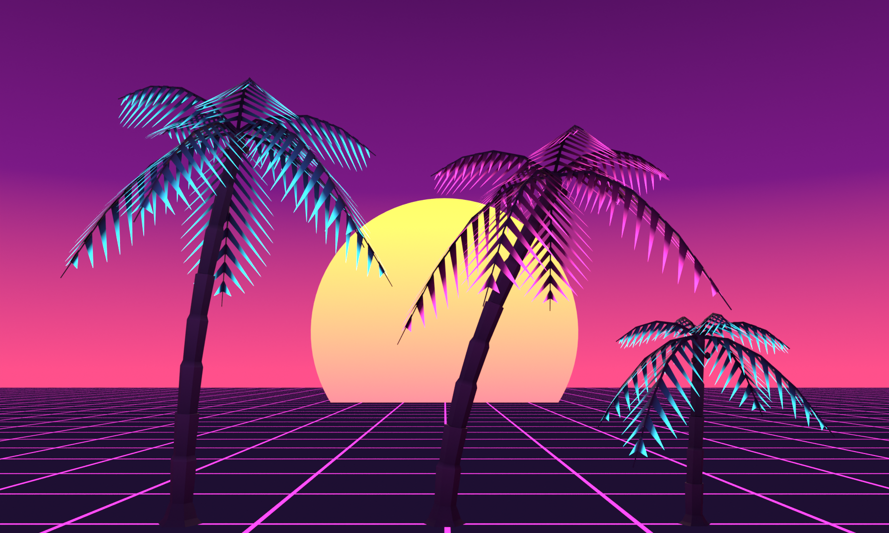

# Synthwave palms

Original Blender palms for the synthwave look (`?theme=synthwave`), where they grow in place of the pines. Built entirely by `scripts/build-palm.py`; no textures or downloaded models.



| Palm | Replaces | Height | Triangles | Far model |
| --- | --- | --- | --- | --- |
| `Palm_Tall` | alpine and snow-dusted pines | 9.3 m | 820 | 56 |
| `Palm_Leaning` | windswept pines | 8.1 m | 770 | 52 |
| `Palm_Young` | stunted treeline pines | 4.4 m | 580 | 48 |

(A pine is 6.8 m and 1,602 triangles.) Heights are before the world's own per-tree scale.

- **Look.** Near-black violet silhouettes: a ringed trunk (stacked segments, each flaring at its top) on a root flare, coconuts under a crown shaft, and two whorls of fronds, the upper arching up and the lower drooping. Each frond is a midrib with slender leaflets hanging either side in a V, swept toward its end. The leaflets run from dark at the rib to neon tips, cyan on the tall and young palms and hot pink on the leaning one, brighter toward the frond's end. Each leaflet is a single triangle, drawn from both sides.
- **Glow.** Opaque vertex colours only. In the game the palms' material (`palmMaterial` in `nature-models.mjs`) makes bright vertex colours emit and leaves the dark ones lit as usual, so the tips glow and the bodies stay silhouettes. The Blender material does the same for its own preview.
- **Breakage.** Six sections per palm, as the pines have: the trunk in three, then the fronds in three groups. They separate on impact and keep their glow.
- **In the game.** `nature-models.mjs` adds the palms after the other trees (variants 6–8) and `variantFor(prop, true)` gives each pine its palm. With synthwave on, the world (`world.mjs` props) leaves many of the pines' spots empty (four in five on open land, one in four in the woods; an empty spot keeps its room, so nothing else moves) and lines the highways and paved roads with tall palms in pairs every 48 m, 4.5 m past the asphalt, clear of junctions, side roads, bridges, water, ramps, camps and steep banks. Past 260–340 m each palm is drawn as its own far model (`<name>_Far`, built with it): the same bent trunk in four sides, and each frond one blade folded down along its rib, widest just before the middle of its arc, its edges reaching about half as far as the leaflets do (they have gaps), darker and only tinged with neon, which is what the leaflets average to from that far. They glow with the same material, so the swap is hard to see.
- **Performance.** Palms are drawn by the thousand, and on an Apple M2 at Retina resolution their GPU cost followed their triangle count (drawing half of each palm's triangles saved over half its cost; a cheaper material, no alpha-to-coverage and no shadow receiving saved next to nothing). The first palms had 1,192–1,924 triangles, each leaflet pair a closed six-triangle wedge, and far models of 80–96. Leaflets as single double-sided triangles, a lighter midrib and trunk, and one-blade far fronds cut the GPU time on a full-speed drive down a palm-lined road from 15.4 to 14.8 ms a frame at High with motion blur, below normal mode's 15.5 ms on the same road with pines.

## Rebuild

```sh
/Applications/Blender.app/Contents/MacOS/Blender --background --factory-startup --python scripts/build-palm.py
```

This writes `palm-trees.blend` (editable, with the preview studio), renders `palm-preview.png`, and exports `palm-trees.glb` and `palm-trees.json` (triangle counts). Keep each palm's root at its ground contact and its six `fragment` sections when editing.
