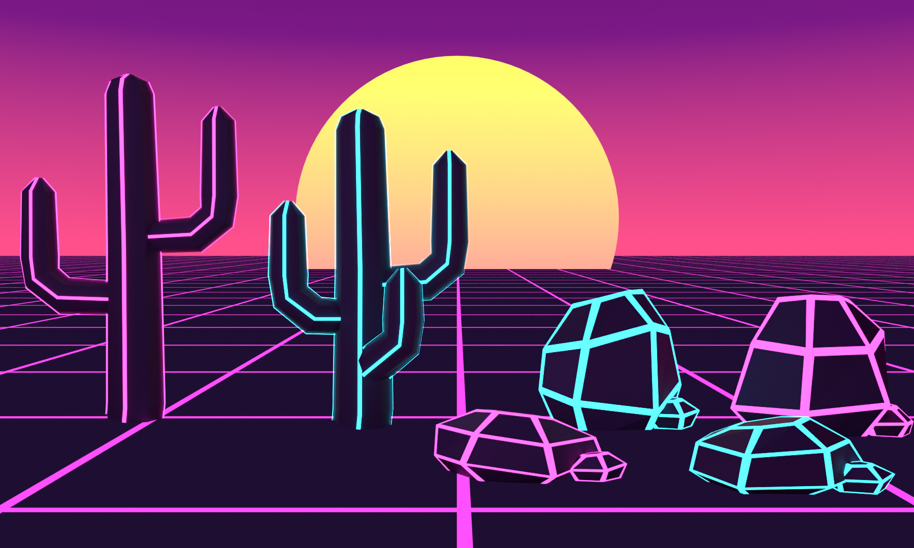

# Synthwave cacti, rocks and boulders

Original Blender props for the synthwave look (`?theme=synthwave`), where they stand in for the everyday cacti, rocks and boulders as the palms do for the pines. Built entirely by `scripts/build-synth-props.py`; no textures or downloaded models. Outcrops and scree, which never break, keep their everyday look.



| Prop | Stands in for | Height | Triangles | Everyday triangles |
| --- | --- | --- | --- | --- |
| `Cactus_Synth_Saguaro` | `Cactus_Saguaro` | 4.5 m | 378 | 970 |
| `Cactus_Synth_Forked` | `Cactus_Forked` | 4.0 m | 504 | 1,170 |
| `Rock_Synth_A`, `Rock_Synth_B` | `Rock_Granite`, `Rock_Shale` | 0.7 m | 309 | 258 |
| `Boulder_Synth_A`, `Boulder_Synth_B` | `Boulder_Granite`, `Boulder_Sandstone` | 1.8 m | 309 | 172 |

Heights are before the world's own per-prop scale, and match the everyday models', so collisions are unchanged.

- **Cacti.** The everyday saguaro's and forked cactus's stems and arms, eight-sided and flat-shaded, near-black violet, with a glowing neon line along every other edge: pink on the saguaro, cyan on the forked one.
- **Rocks and boulders.** Broken stones of jittered rings, as the everyday ones, with uneven facets: each facet is a dark inset face framed by thin neon strips, so the stone reads as edged in light, like the wireframe mountains. Cyan or pink by variant.
- **Glow.** Opaque vertex colours only, in the palms' material (`palmMaterial('Synth_Glow')` in `nature-models.mjs`): bright colours emit, dark ones are lit as usual.
- **Breaking.** Cacti, rocks and boulders shatter into debris as before; in synthwave the pieces are dark violet, one in three a glowing neon pink or cyan (`debris.mjs`).
- **In the game.** `addSynthProps` in `nature-models.mjs` adds them after each kind's everyday models, and `variantFor(prop, true)` gives each prop its stand-in. Everyday choices are made from the everyday models alone. Past 260–340 m they are the usual stand-in shapes in a dark violet.
- **Cost.** Driving through the desert at seed 100003 on an Apple M2 at Retina resolution, they cost 0.13 ms a frame more than the everyday props.

## Rebuild

```sh
/Applications/Blender.app/Contents/MacOS/Blender --background --factory-startup --python scripts/build-synth-props.py
```

This writes `synth-props.blend` (editable, with the preview studio), renders `synth-props-preview.png`, and exports `synth-props.glb` and `synth-props.json` (triangle counts). Keep each root at its ground contact, with its `kind` and `variant`.
